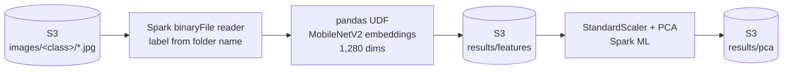

# Scalable image feature extraction with PySpark on AWS EMR

[](https://github.com/Yassaadi/Scaling_cnn_emr/actions/workflows/ci.yml)

> Re-implementation on public data of an approach I delivered in a freelance engagement. Client data and code are confidential and not included; this version uses public fruit images ([Fruits-360](https://www.kaggle.com/datasets/moltean/fruits)).

## The problem

An AgriTech start-up wants a fruit recognition engine for a mobile app, as a first step towards harvesting robots. The image volume will grow quickly, so the first deliverable is not a model but a **data pipeline that scales**: ingest images, turn each one into a compact numeric representation, and reduce its dimensionality, on infrastructure that can grow with the data.

## Solution



| Concern | Choice |
|---|---|
| Representation | Transfer learning: MobileNetV2 pre-trained on ImageNet, classification head removed, giving a 1,280-d embedding per image. Chosen for speed and a compact output |
| Distribution | Embeddings computed in an iterator **pandas UDF**: the model is built once per task and fed Arrow batches; weights are **broadcast** from the driver instead of downloaded by every executor |
| Dimensionality reduction | Standardisation and PCA in Spark ML, so the reduction scales with the data too |
| Infrastructure | Transient **EMR** cluster created by script, with a bootstrap action for Python dependencies, the job submitted as a step, and **auto-termination** so compute is only paid while the job runs |
| Storage | S3 for input images, intermediate features and results (Parquet) |
| Portability | The same script runs locally (`local[*]`) and on EMR; only the paths change |

## Results

On the EMR run over 3,110 test images:

- 1,280-dimensional embeddings extracted for every image and written to Parquet;
- the first 20 principal components keep **54%** of the variance; the first two keep 18%, used for a 2-D projection of the classes;
- scaling up means adding core nodes (`CORE_NODES=…`) without changing code.

## Quick start

**Locally** (Java 17+):

```bash
pip install -r requirements.txt
spark-submit --master "local[*]" src/extract_features.py --input data/sample --output output --pca-k 20
```

`data/sample` should contain one sub-folder per class with `.jpg` images (for example a few folders from Fruits-360).

**On AWS EMR** (AWS CLI configured, images uploaded to `s3://$BUCKET/images/`):

```bash
aws emr create-default-roles   # once per account
BUCKET=my-bucket ./emr/run_on_emr.sh
```

The cluster installs dependencies, runs the job, writes `s3://$BUCKET/results/{features,pca}` and shuts down.

**Tests:** `pip install -r requirements-dev.txt && pytest` runs the full pipeline on a local Spark session with generated images (random weights, so no download is needed). CI runs the same tests on every push.

## Repository structure

```
src/extract_features.py      Spark job: load → embed → scale → PCA → Parquet
emr/run_on_emr.sh            transient EMR cluster with auto-termination
emr/bootstrap.sh             dependency installation on every node
tests/                       end-to-end test on local Spark
notebooks/                   original exploration: local prototype and EMR run (in French)
```

## What I would add in production

- Train a classifier on the embeddings and track it in a model registry
- Incremental processing (only new images) with a manifest or Delta/Iceberg table
- Spot instances for core nodes, and cost and run-time monitoring per job
- Infrastructure as code (Terraform or CDK) instead of a CLI script
